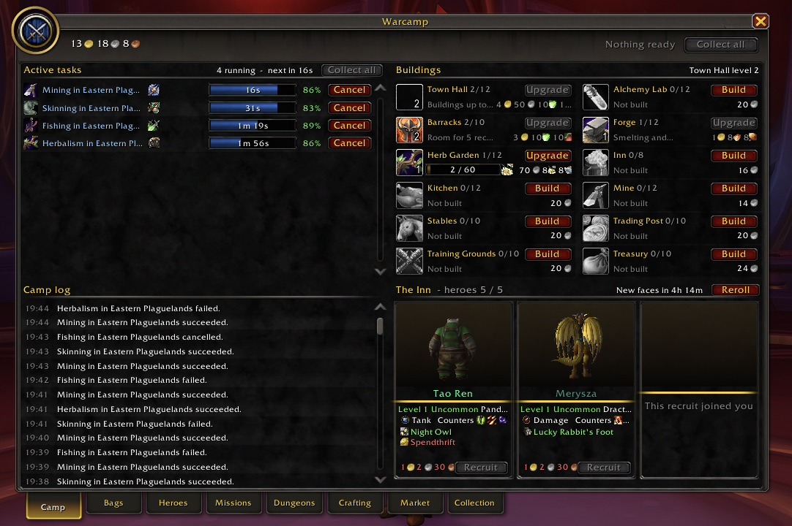
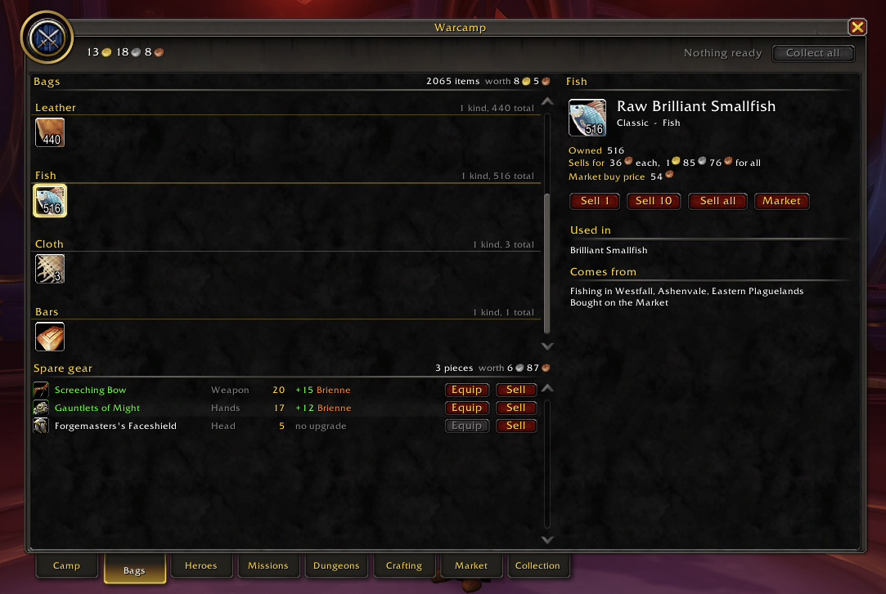
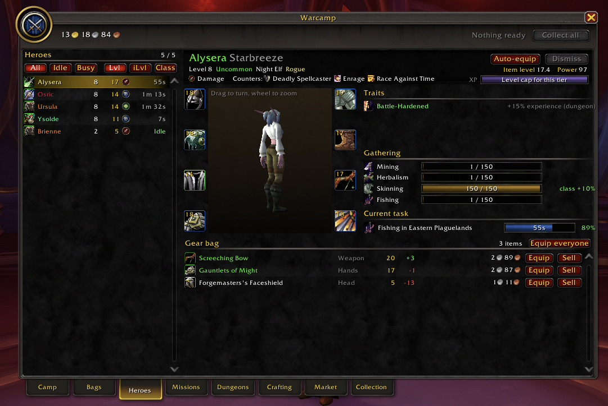
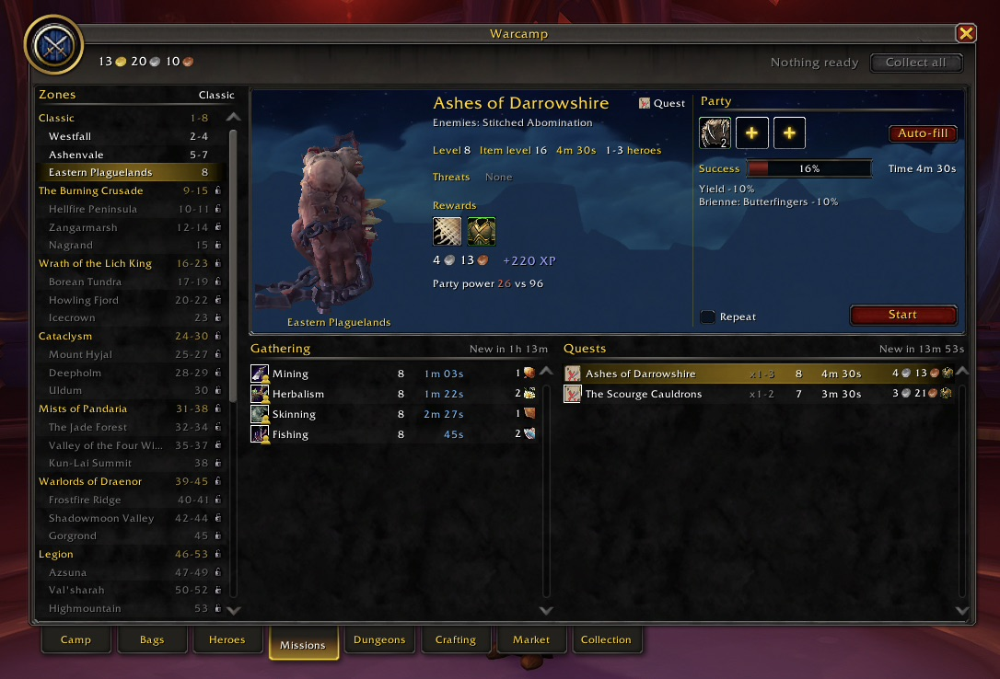
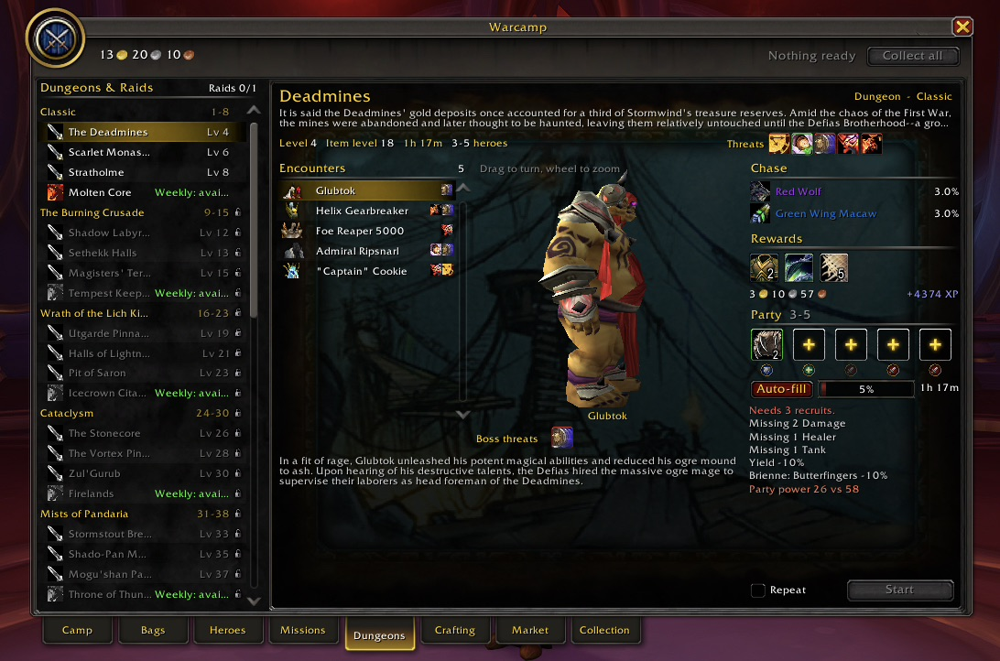
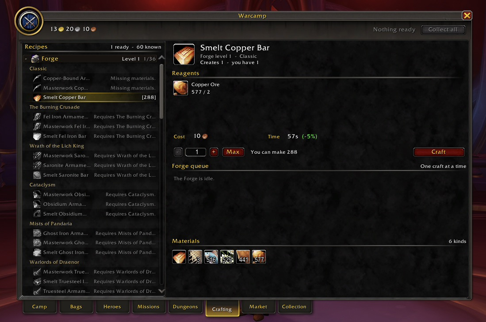
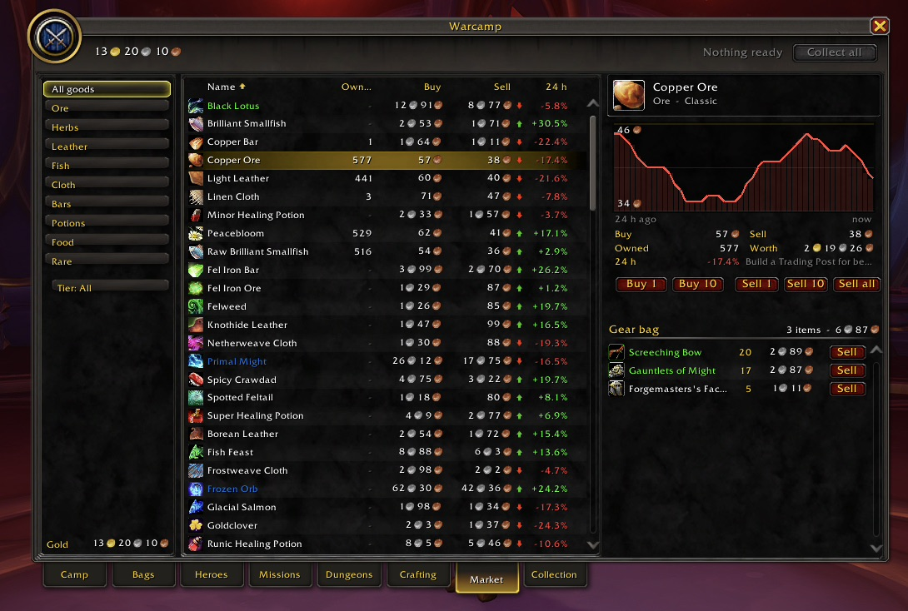
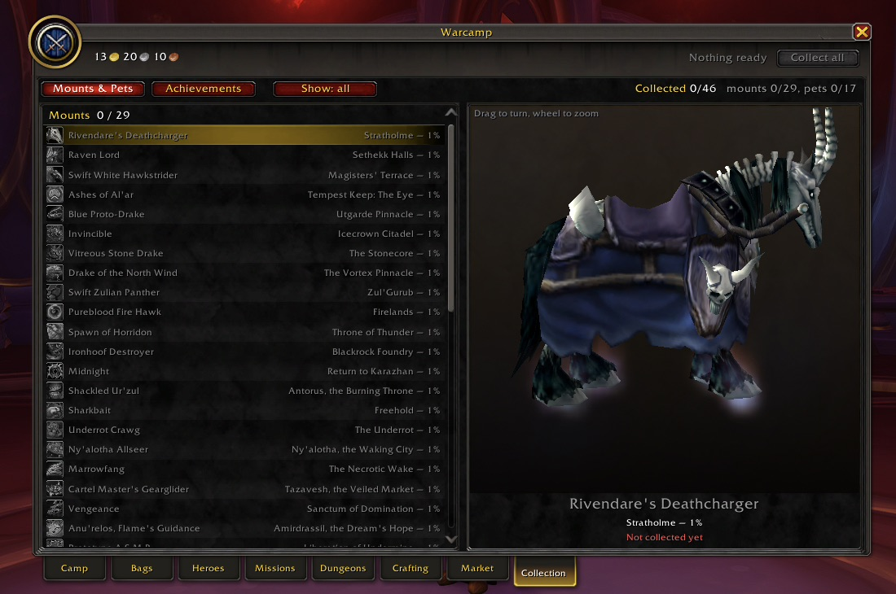
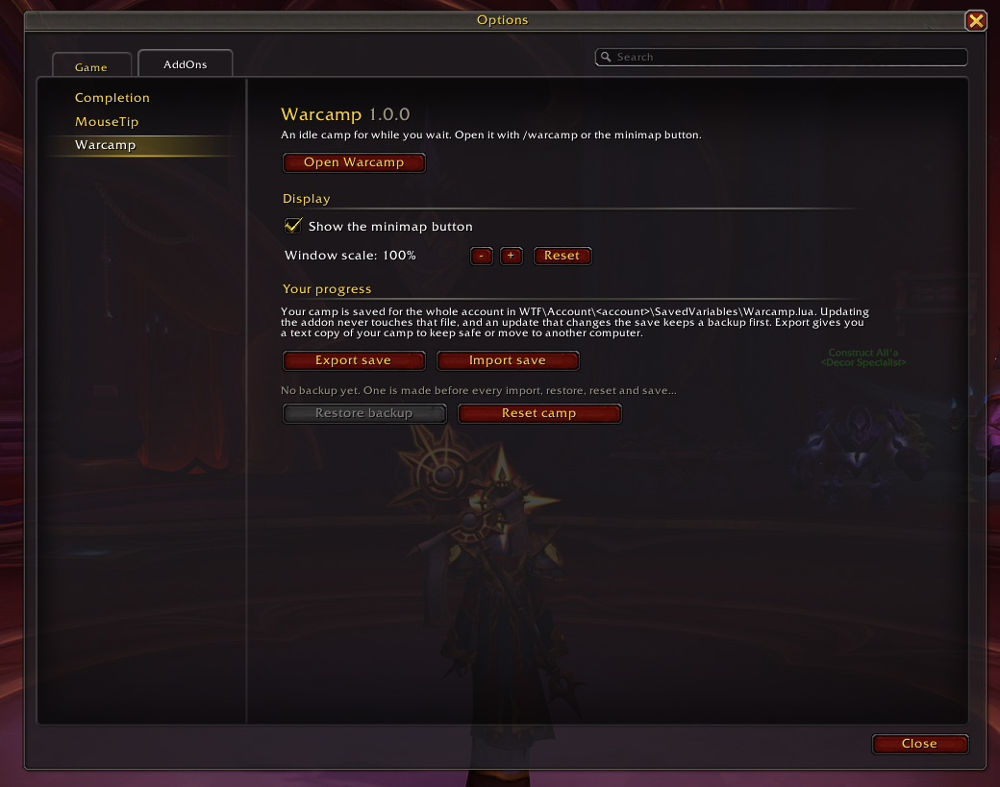

# Warcamp

**An idle game that lives inside World of Warcraft.**

Stuck in a queue? On a long flight path? Waiting for the group to fill? Open Warcamp, send your recruits out, and get back to playing. They gather, quest, clear dungeons and raid while you do your own thing, even while you are logged out.

Your recruits are not your real characters. They are a camp of heroes you hire, gear up and send on missions, all in the familiar Blizzard look: real item icons, real 3D models for recruits, enemies, bosses, mounts and pets, and every expansion from Classic to The War Within.

Type **/warcamp** or click the minimap button to begin.

---

## How it plays

1. **Recruit** heroes at the Inn. Each has a class, a role, traits and a 3D look.
2. **Send them out**: gathering and quests take minutes, dungeons take an hour or more, raids are weekly.
3. **Come back** when it suits you, collect the loot and send them out again.
4. **Grow**: upgrade buildings, craft better gear, unlock the next expansion and chase mounts and pets.

Tasks can **repeat**, and repeating tasks keep going for up to **12 hours while you are offline**. Log in to a welcome report of everything your camp did while you were away.

---

## Camp

Your base (pictured at the top). Running tasks, the camp log, twelve buildings to upgrade and the Inn, where new recruits arrive every few hours.

## Bags

Everything you own at a glance: materials, potions, food and spare gear. Each item shows what it is worth, which recipes use it and where to get more. Spare gear shows which recruit it would upgrade, with one-click Equip.

## Heroes

Your roster with a 3D model, gear, traits, gathering skills and current task. Auto-equip one hero, or equip everyone in one click.

## Missions

Gathering and quests in 36 zones across every expansion. Pick a party, check the success chance and the rewards, and go. Threats and counters reward a good party over a strong one.

## Dungeons & Raids

36 dungeons and 12 raids with their real bosses, lore and models from the Adventure Guide. Build a party with a tank, healer and damage, beat the boss threats and chase rare mount and pet drops. Raids lock weekly.

## Crafting

60 recipes across the Forge, Alchemy Lab and Kitchen: smelt bars, forge armour, brew potions and cook feasts that buff your recruits.

## Market

A living market. Prices drift through the day, and selling a lot pushes the price down. Buy what you are missing, sell what you have too much of, and watch the 24-hour chart.

## Collection

29 mounts and 17 pets to win from dungeons and raids, each shown as a 3D model, plus 45 achievements. When you have done it all, start a **New Era**: begin again with a permanent bonus to experience and gold.

---

## Your real play helps too

Finishing a real dungeon, Mythic+ or delve gives your camp a **Rallying Cry** buff.

## Light and quiet

- No sounds, no screen alerts, no pop-ups while you play. The only notice is a ready count on the minimap button.
- Nothing runs while the window is closed except one tiny 5-second check.
- No changes to your game settings or key bindings.

## Your progress is safe

- Progress is saved for your whole account and is never touched by addon updates.
- Before an update changes how progress is stored, Warcamp keeps a backup of your camp first.
- If an update removes something your camp still holds, Warcamp quietly cleans it up instead of breaking.
- **Export** your camp as a text string at any time to keep it safe or move it to another computer, and **Import** it back.
- Every import, restore and reset keeps a backup, so you can undo it from the options page.

## Commands

| Command | What it does |
|---|---|
| `/warcamp` or `/wcamp` | Open or close the camp |
| `/warcamp bags` (or any tab name) | Open a tab |
| `/warcamp options` | Options: minimap button, window scale, save tools |
| `/warcamp export` / `/warcamp import` | Copy your camp to or from a text string |
| `/warcamp help` | List everything |

Options are also in **Options > AddOns > Warcamp**.

---

Found a bug or have an idea? Leave a comment. Screenshots help a lot.
